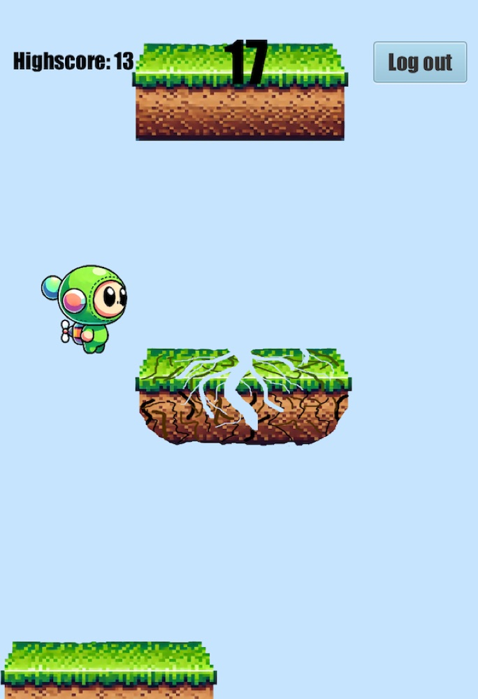

# JumpyJump – plattformspill i JavaFX

Plattformspill inspirert av Doodle Jump. Laget alene som semesterprosjekt i TDT4100 Objektorientert programmering ved NTNU, våren 2025.



## Funksjoner

- Registrering og innlogging av brukere
- Highscore per bruker, lagret i en fil i hjemmemappen
- Observer-mønster mellom spillogikken (`GameState`) og visningen (`GameController`)
- Enhetstester i JUnit 5

## Kontroller

| Tast | Handling |
|---|---|
| `A` / `←` | Gå til venstre |
| `D` / `→` | Gå til høyre |

Figuren hopper automatisk når den lander på en plattform.

## Kjør prosjektet

Krever JDK 21 eller nyere og Maven.

```bash
mvn javafx:run
```

Kjør testene:

```bash
mvn test
```

## Struktur

```
src/main/java/project/
├── ProsjektApp.java        Starter appen og bytter mellom menyen og spillet
├── controllers/            Kobler FXML-visningene til logikken
├── game/                   Spillogikk: spiller, plattformer og spilltilstand
├── persistence/            Lagring og innlasting av spillinformasjon
└── user/                   Brukere og innlogging
src/main/resources/project/ FXML-visninger og bilder
src/test/java/project/      JUnit-tester
```

Klassediagrammet ligger i [ClassDiagram.md](src/main/java/project/ClassDiagram.md). Prosjektrapporten ligger i `OOP prosjektoppgave.odt`.
